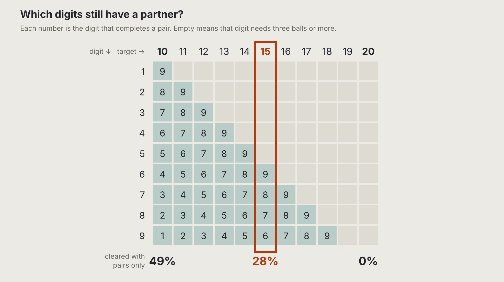

For a while I tried to make target 10 boards more varied. Different mixes of group sizes, a rule against repeating the same pair nearby, groups that fill a whole box. Each tweak helped a bit, and each one felt like a patch.

Then it clicked. A lot of the tweaks and hacks were a symptom of target 10 itself being a very special case. It's the only target where every digit has a partner: a 9 needs a 1, an 8 needs a 2, all the way down to 5 and 5. From 11 up the smallest digits lose theirs. At 18 only 9 + 9 is left, and from 19 on no pair exists at all. Much of what I was trying to fix at 10 wasn't a bug in the builder. It was just what 10 is like.

20 is a special case too, from the other end. A 1 can't even sit in a group of three there, it needs four balls or more.

So which target is the normal one? Two balls add up to 10 on average, three to 15, four to 20. At 15 the big digits, 6 to 9, still pair up, and the small ones need friends. Claude measured how much of a generated board you can clear with pairs only: 49% at 10, 28% at 15, nothing at 20. 15 sits in the middle. Pairs help, but they don't solve the board.

So Klaar! now starts on target 15, on the middle-sized board. 10 stays as the familiar one and 20 as the special one. Whether 15 is the standard target for Klaar!, we will see through playtesting.
