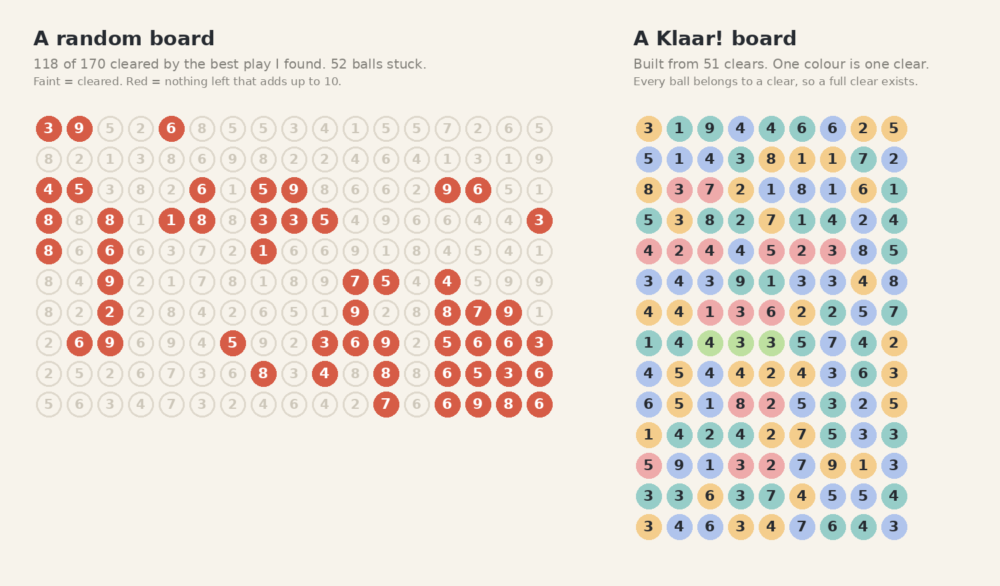

While testing the timed mode I caught myself favoring picking a corner to sweep the board clean. Compared to typical apple-box games, it definitely felt too easy.

So I played a quick apple game to compare and got 77 out of 170, and the end card said there were no moves left.

Here is the thing about that 170. As far as anyone has measured, an apple-box board is just random digits, drawn again until the total is a multiple of 10. [A developer checked 500 of those boards](https://apple.oshizi.com/about/board-generation/) and that is all they found. Nothing makes sure the board can be cleared, so a lot of apples are simply there to block you. My guess is that 170 digits against a two-minute clock is what makes it feel like an arcade game. A lot to look at, with little time, and the randomness does the rest.

So I asked Claude to test it. We made 26 boards the same way and let a computer play each one, with a search plus a few dozen playthroughs that took whatever sum they could find. It never found a full clear. The best it managed on a board was between 90 and 154 apples, and about 118 in the middle. That is around 70%. I can't prove that no board allows 170, but I couldn't find one. So 170 is not the top score. It is just how many apples there are.

Here is a typical random board next to a Klaar! board. On the left, the best play the computer found: 118 of 170 cleared, 52 apples stuck. On the right, a Klaar! board with the clears it was built from, one colour for each.

A Klaar! board is built backwards, from its last clear, so there is always a way through. Every ball is part of a clear. That is the promise, and it is also why picking a corner works so well. A player who takes any valid move without thinking clears about 85% of a target 10 board, and over 90% at target 15. On a random apple-box board it is about 60%. A board that is built to work is easy to peel from the outside, and a board that isn't is hard because of the blockers.

I don't want to copy their approach to difficulty. But I think we can do better than picking a corner and making our way down. Boards that still have a way through, but don't hand it over, with decoys and dead ends on the way. The builder we have now may be the right one for an easy, learning mode, and a second builder could make the puzzles. At the moment, I have no idea how to build that one yet.
