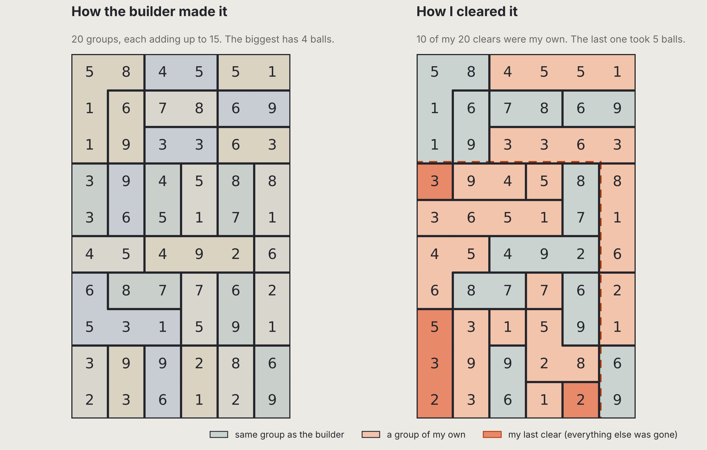

Every Klaar! board is built backwards. The builder starts with an empty grid and places the last clear first, then the one before it, and so on. That way every board can always be cleared. That's the promise.

But the builder only knows one way through, and a player doesn't have to use it.

Here is the same 6 × 10 board twice. On the left, the 20 groups the builder made. On the right, the 20 clears I made when I played it. Ten of them were groups the builder never made.

The biggest group the builder made on this board has four balls. My last clear took five: 3, 5, 3, 2 and 2, from a box where everything else was already gone. Nobody planned that one. It wasn't a fluke either, another 6 × 10 board gave me 11 of 21.

This is what I was hoping for. A board that is guaranteed to work, but doesn't feel like following a recipe. You find your own clears, and sometimes they're bigger than anything the builder had in mind. To me that is what makes a puzzle feel natural.

What I don't know yet is how far that goes. Will people enjoy the puzzles while discovering their own solutions, or will they quickly encounter predictable patterns?
