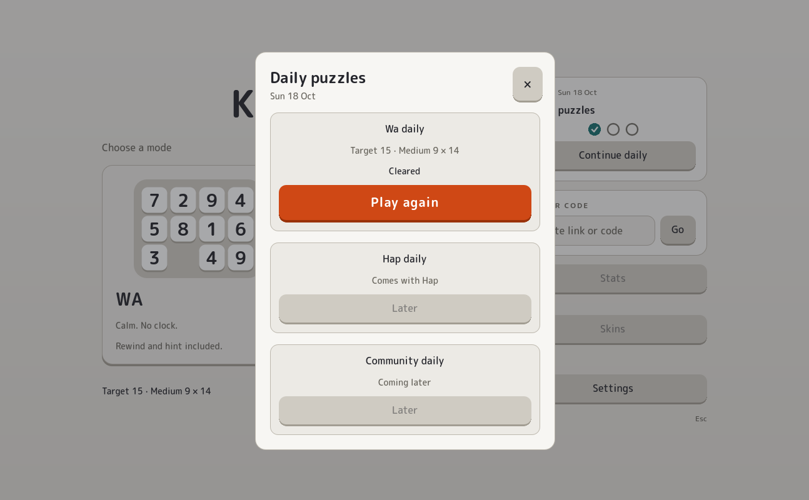

Today the first daily puzzle went live in Klaar!, and I played it twice: once on my desktop and once on my phone.

Same board, but not the same game. On the desktop I cleared it with one rewind. On the phone I think it was about six rewinds and five hints.

Everybody gets the same board on the same date, and everybody has a personal experience of it. I like thinking that people all over the world are briefly enjoying this exact puzzle today, each in their own way. That is what I wanted from a daily.

There is no server handing the board out. Your device takes today's date, turns it into a number, and builds the board from that number. Every device does the same sum, so everyone ends up with the same board. It changes at midnight where you are, so it's the same date, not the same moment. You can replay it as often as you like.

What I left out on purpose: no streaks, no count of days, no global leaderboard. I don't want the pressure, or the dark pattern, of daily logins. This is for personal enjoyment, a bit of shared play. If you miss a day, nothing happens. Every daily you play is simply a moment kept in your own saved games, with a label saying it was a daily.
