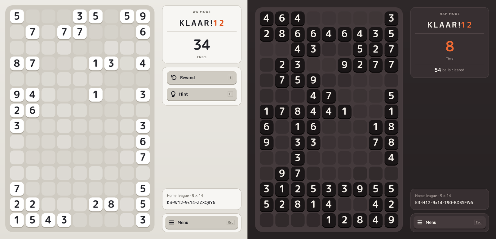

When you clear a group of tokens in Klaar!, they leave something behind. A flat, quiet mark in the exact place where they stood, a little different from the board around it. I call it a footprint.

I see it as the footsteps of a player solving a puzzle. I have always been charmed by the notion of fleeting memory leaving a mark. It is likely to be unnoticed, and will definitely be forgotten. And that's okay. The game briefly remembers, showing it in a subtle and calm manner, before it also releases it away without a trace.

Every footprint gets its shade the moment you clear it. In Wa the shade follows how much of the board you have cleared. The first footprint is very close to the board colour, and the last one stands out most. On a 9 × 14 board that is 126 tiny steps. On a smaller board the steps are bigger. The bigger the board, the subtler the steps.

In Hap the shade follows the clock instead. Clear quickly and your traces will be quite "light-footed". The aesthetics remind me of Chung Sanghwa (정상화)'s Dansaekhwa (단색화), Korean monochrome painting. By the end of a game, your board is a grid of soft colour fields.

On the dev side, I got the colour order wrong at first. Something felt off in the first version, and I wondered if light and dark skins needed different rules. They don't. Claude measured the values and both skins did exactly the same thing. Right now, the first footprint sits closest to the board colour and the last one stands out most, gradually building up as you play.
