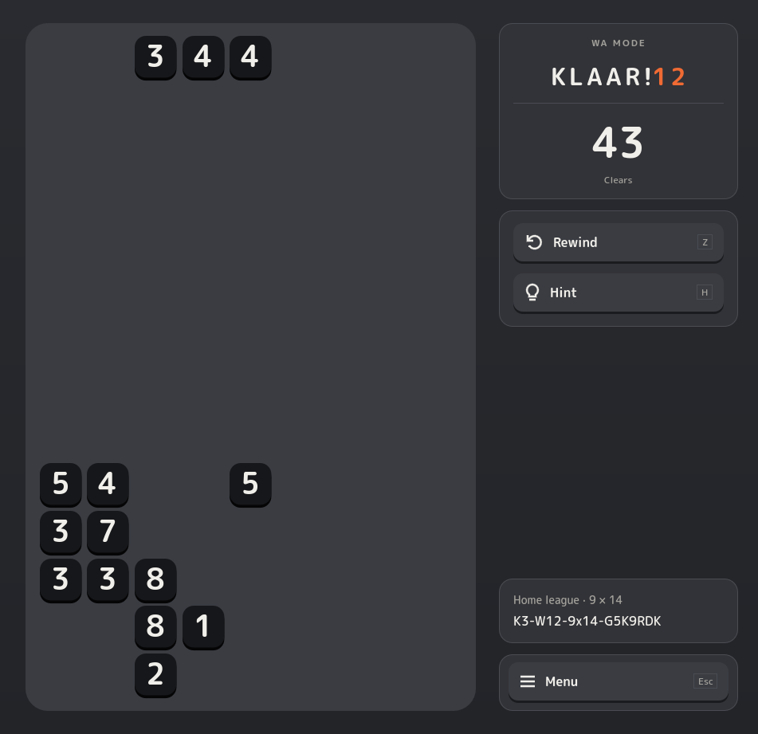

I caught myself staring at this board on my second screen, in between working on Klaar! and other design projects. It is a medium sized Wa board, target 12, I guess I couldn't find the next 12.

Here is that same board from the start, if you want to try it: [play this board](https://opgeruimdebende.github.io/play/klaar/?p=K3-W12-9x14-G5K9RDK).

Aside from admitting I am by no means the best Klaar! player myself, it is like a streamer playing a puzzle game with tunnel vision while everybody watching sees the answer and pulls their hair out. Or a colleague walks past, glances at the screen, and sees it at once.

What I liked about that moment is that nothing was rushing me. The board just sat there and waited. It made me think of a chess or Go board left out in a lounge, or an online game where two players come back to it after long gaps. Wa has no timer, so it can be that kind of game: open on the side, slowly working towards a perfect clear with as few rewinds as possible. I hope it gives people a bit of joy and comfort in a busy day.

But that asks something of me as the developer. A game that waits has to be light and reliable. It cannot hog resources while it sits idle, waiting for you to come back. It doesn't nudge impatiently. It cannot crash or lose your save. And the worst would be a board that lies, one that turns out not to be clearable. These break expectations, and I lose a player.

I have to admit the code is not there yet. Getting it as light and as reliable as I want will be hard work. This also explains why Klaar! is one web package, with no ads, no accounts and no server, at least for now, unless some function really needs a simple or serverless connection.

Quiet, old-school, pretty much invisible. That is what I want it to be. This post is also a reminder to myself of what the goal is under the hood.
