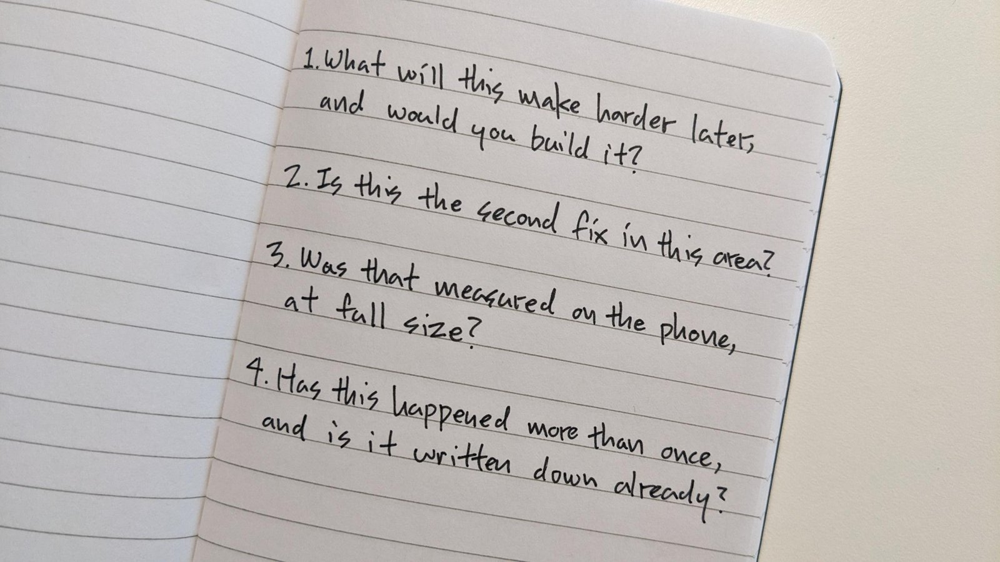

After the cold review, a post-mortem of the cold review, and one more round to fix more issues on the phone, I wanted a final pause before we go back to work. Not to blindly question and undo what we have achieved, but to educate myself on how to work better. This was part of that conversation with Claude, gently cleaned up and condensed.

**Me:** How do we have reassurance that we won't repeat the exact same mistakes the post-mortem found? I'm not saying that magically we will not make any mistakes. If it's something new, of course we are. But mostly about not repeating the same ones.

**Claude:** Most of those mistakes didn't come from not knowing better. One lesson was written down on the 16th and repeated on the 19th. Another part of the code was named as a pile of stacked fixes, and that same day we added one more. The lessons were there, but they lived in documents, and documents get forgotten when you move fast. So what changed is where the lessons sit. They are now inside the steps of the work: in what we ask before agreeing a feature, in how a bug fix has to be described, in the checks after every step. Like a pilot's checklist. The pilot knows how to fly. The checklist is there because knowing isn't enough at 2 a.m.

**Claude:** It matters for me in particular. Every new conversation I start has no memory of the last one. A lesson left in an old conversation reaches no one. A lesson written into the way we work reaches every future one.

**Me:** And how do we make sure we don't over-engineer things, and that we are able to be critical about our issues, especially in troubleshooting? This is not a leading question to introduce more code and safeguards. We spent nearly a week doing that.

**Claude:** Fair, since the cold review was about too much code. Most of this is a line in how we work, not new code. Build the smallest thing that answers the question you have now. A fix that adds a new setting or a special case has to explain why. A fix that removes code is usually a good sign. And when something breaks, name the cause before the fix. If we don't know the cause yet, the next step is finding it. If it's the second fix in the same place, we stop patching and ask how the platform itself solves it.

Claude gave me three questions to ask whenever we discuss a decision. What will this make harder later, and would you build it? Is this the second fix in this area? Was that measured on the phone, at full size? If we can't answer them plainly, that is telling.

**Me:** I used to ask you this every time: before you propose a new skill edit, would leaving it out cause a mistake in a future session, and has this happened more than once, or is it a one-off from today? It stopped you nine out of ten times from adding something. I want to add something like this as a fourth question.

**Claude:** Has this happened more than once, and is it written down already?

As we concluded this conversation, Claude offered to write everything up as a short document to keep with the project. I asked what that would be for.

**Claude:** Your fourth question says not to make it. Everything a future session needs is already written down where it belongs. A second copy would drift out of date, and then you have two versions that disagree. That's exactly what the cold review kept finding in the code. Your written notebook already does the job.

