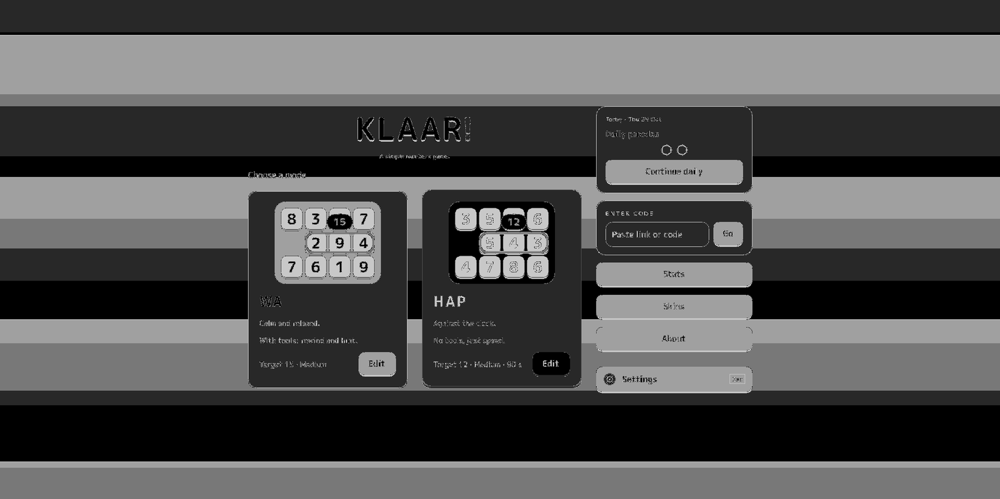
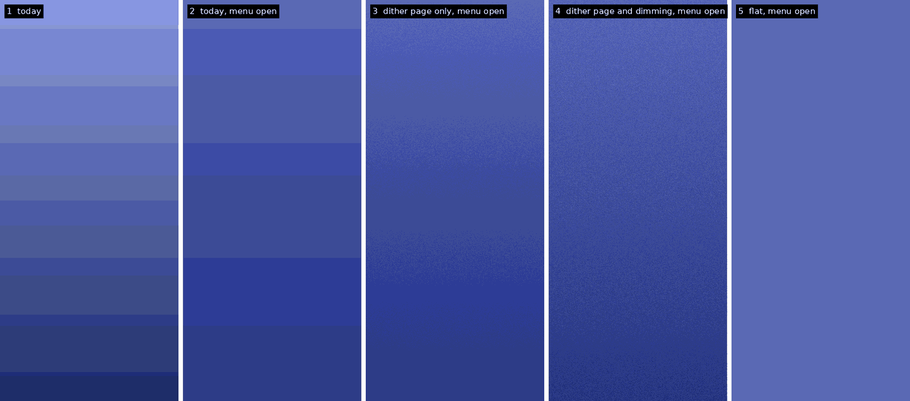

I noticed that when you opened a menu in Klaar! on the desktop, in the dark skin, lines ran across the background. Horizontal stripes, sliding up the screen as the menu came in. It looked like a monitor about to die. For a moment I thought my GPU or my screen was damaged.

We had already been fixing things around the background for a few rounds. At first it was about a real flicker: the dark layer behind a menu was drawn for two frames before the menu itself. Then we were dealing with a problem with how the menu card faded in. And then the banding.

After a couple of misdiagnoses, it turned out the background had a forgotten gradient, a soft fade from a slightly lighter grey at the top to a slightly darker grey at the bottom, left behind from lazy ideation during the very beginning of the project. In the dark skin, top and bottom were only seven shades apart. A screen can't show anything between two neighbouring shades, so my soft fade was really seven or eight flat stripes, each about 45 pixels tall.

When a menu opens, a dark layer fades in over the page to push it back. Under that layer only four shades were left, so every stripe edge jumped to a new place while it faded in. That was the movement. The light skin has the stripes too, just too faint for the eye at those brightness levels.

Claude simulated different ways to gradient or dither the background. We decided to keep it flat and clean. The lazy gradient wasn't helping the polish of the game, and simply removing it reduced code instead of adding more.

This meant going back over the fixes we made while we were looking in the wrong place. The first one was right and stays. The second added a fade and an extra switch to cover up the card's own fade, when the simpler move was to stop fading the card. The third did stop fading the card, but it blamed the card for the moving lines and kept the one fade that made the stripes jump. It also gave desktop menus their own speed and easing, different from the phone, for a reason that no longer exists. We decided to undo that now, so that the dark layer appears at once, as on the phone, and both move the same way again.

I feel like I'm stuck in a loop of taking two steps forward and one step backward in order to proceed one step in this cycle of bug fixing.
